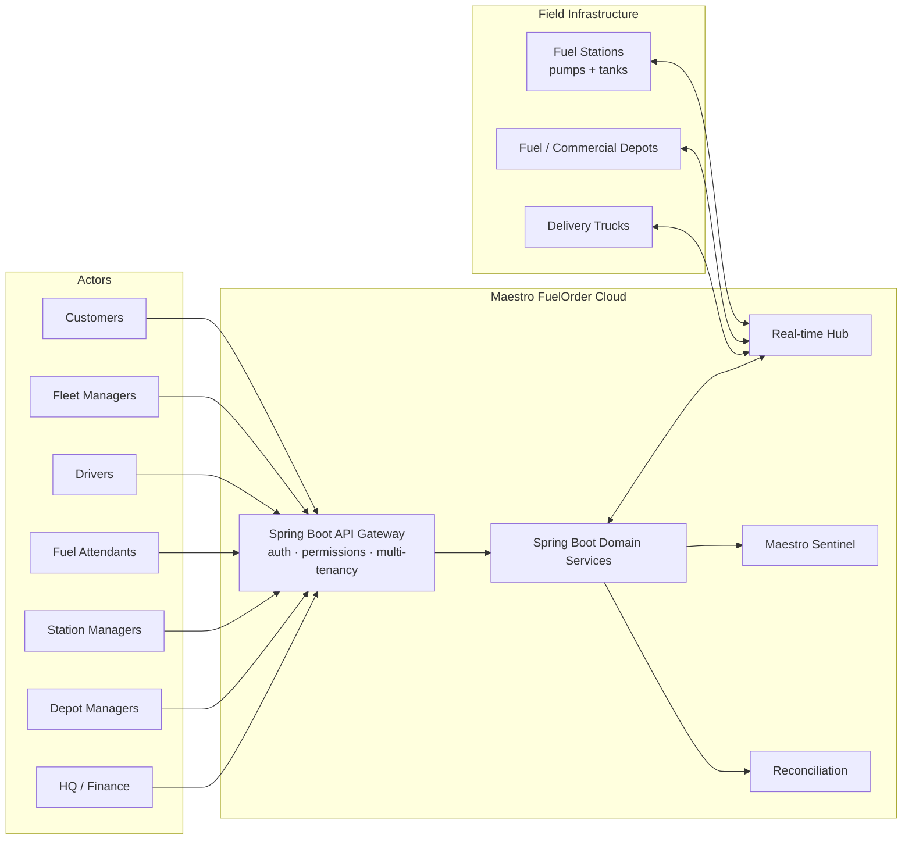

# Maestro FuelOrder™

**An advanced cloud-based fuel ordering and dispensing management platform** that connects
customers, fuel stations, commercial depots, fuel depots, drivers, fuel attendants and fleet
managers in one intelligent ecosystem.

Maestro FuelOrder goes beyond OTP fuel authorization: it combines fuel ordering, approval
workflows, automated dispensing, tank monitoring, real-time pump monitoring, customer-specific
pricing, fraud detection, fleet intelligence, delivery tracking and financial reconciliation.

## Technology stack

| Layer | Technology |
| ----- | ---------- |
| Web application | **React + TypeScript** — Maestro Web Portal, role-based workspaces (Customers · Suppliers · Administrators) |
| Mobile application | **Kotlin Android** — Maestro Android App (Attendant mode: rugged tablets / Maestro POS · Driver mode: phones) |
| Backend | **Java 21 + Spring Boot** — API Gateway (auth · permissions · multi-tenancy) + modular domain services |
| Database | **PostgreSQL** (+ TimescaleDB extension) — transactions · telemetry · events · audit logs |
| Cache and OTP state | **Redis** |
| Live equipment monitoring | **MQTT / WebSocket** (ATG, Maestro Controllers, bulk flow meters, GPS) |
| Background events | **RabbitMQ or Kafka** |
| AI fraud analytics | **Python services** (Maestro Sentinel™ risk models, CCTV event detection) |
| CCTV integration | **ONVIF / supported VMS APIs** |
| Reports | **JasperReports / Apache POI** (PDF invoices, statements, Excel exports) |
| Cloud deployment | **AWS or equivalent infrastructure** |

## Documentation index

| # | Document | Contents |
|---|----------|----------|
| 1 | [System overview](./docs/01-system-overview.md) | Vision, actors, capability map, module breakdown |
| 2 | [Architecture](./docs/02-architecture.md) | Logical architecture, Spring Boot module layout, clients, real-time design |
| 3 | [Data model](./docs/03-data-model.md) | ERD and table-by-table definitions |
| 4 | [API design](./docs/04-api-design.md) | REST resources, WebSocket/MQTT events, error model |
| 5 | [Core workflows](./docs/05-core-workflows.md) | Sequence diagrams: ordering, OTP dispensing, delivery, reconciliation |
| 6 | [Security & fraud detection](./docs/06-security-and-fraud.md) | AuthN/AuthZ, RBAC, OTP design, fraud rules engine |
| 7 | [Infrastructure & deployment](./docs/07-infrastructure.md) | Cloud topology, environments, CI/CD, observability |
| 8 | [Delivery roadmap](./docs/08-roadmap.md) | Phased implementation plan |
| 9 | [Implementation status](./docs/09-implementation-status.md) | What is built, how it was verified, what is simulated, how to run it |
| 10 | [Station server integration](./docs/10-station-server-integration.md) | How pumps, tanks and RFID talk to the PTS-2, and how station data syncs to the cloud/VPS |

## The ecosystem at a glance

