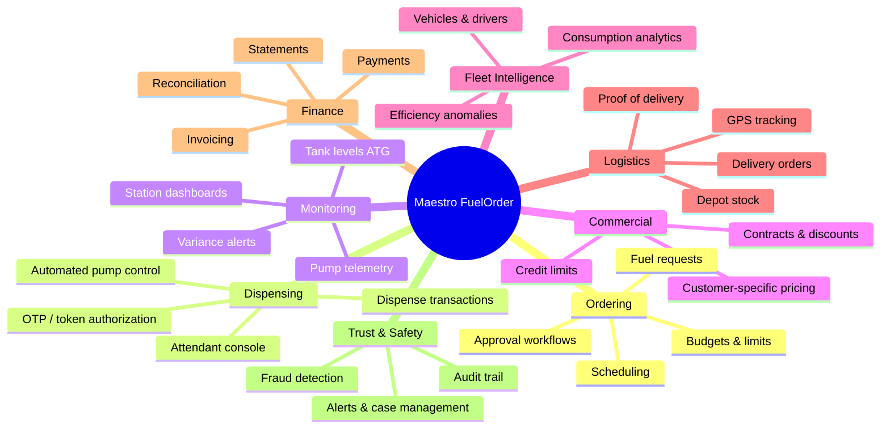

# 01 · System Overview

## 1. Vision

Maestro FuelOrder™ is a cloud-based platform that digitizes the entire fuel lifecycle —
**order → approve → dispense → deliver → reconcile** — for fuel retailers, commercial depots
and fleet operators. It replaces paper vouchers, manual OTP tools and disconnected spreadsheets
with one intelligent, auditable ecosystem.

## 2. Actors & personas

| Actor | Description | Primary client |
|-------|-------------|----------------|
| **Customer (Org Admin)** | A commercial customer (company) buying fuel on contract; manages branches, users, vehicles, budgets | Web Portal — Customer workspace |
| **Fleet Manager** | Manages vehicles, drivers, fuel limits and approval of fuel requests inside a customer org | Web Portal — Customer workspace |
| **Driver** | Requests fuel for an assigned vehicle; redeems OTP/token at pump; signs digitally | Android App — Driver mode (+ Web Portal) |
| **Fuel Attendant** | Validates OTP/QR, verifies driver & vehicle, operates the pump, captures signatures | Android App — Attendant mode (rugged tablet / Maestro POS) |
| **Station Manager** | Oversees a station: pumps, tanks, shifts, local sales, incidents | Web Portal — Supplier workspace |
| **Depot Manager** | Manages depot stock, loading bays, bulk flow meters, loading schedules | Web Portal — Supplier workspace |
| **Delivery Driver** | Hauls fuel depot → station/customer; status + GPS tracking; proof of delivery | Android App — Driver mode |
| **HQ Finance / Admin** | Pricing contracts, invoicing, reconciliation, fraud review, platform administration | Web Portal — Admin workspace |
| **Devices** | Maestro Controllers (pumps / bulk flow meters), automatic tank gauges (ATG), GPS trackers | MQTT |

## 3. Product surfaces

Two client applications, each **role-based** — users see only the workspaces their scoped
roles grant (Customers · Suppliers · Drivers · Attendants · Administrators):

| Client | Form factor | Role-based workspaces |
|--------|-------------|-----------------------|
| **Maestro Web Portal** | React SPA (responsive) | **Customer workspace**: branches, vehicles, drivers, purchase orders, fuel budgets, allocations, order approvals, transaction histories, credit balances, delivery receipts. **Supplier workspace (Station & Depot Control Centre)**: available stock, live pumps, loading bays, bulk flow meters, supplier review inbox, dispenser utilization, loading schedules, depot operational status, **Wetstock Intelligence** dashboards (ATG, TC volumes, water levels, variance, leakage investigation). **Admin workspace**: pricing & contracts, billing, reconciliation exceptions, Maestro Sentinel fraud room, platform administration |
| **Maestro Android App** | Kotlin Android; rugged tablets / Maestro POS (attendants), phones (drivers) | **Attendant mode**: OTP verification, QR scanning, driver identity checks, vehicle verification, dispensing authorization, digital signatures, receipt printing, offline queue. **Driver mode**: fuel requests, OTP/QR wallet, delivery runs, GPS status, proof-of-delivery capture, delivery confirmation |

## 4. Capability map

## 5. Functional modules

### M1 — Fuel Ordering & Approval Workflows
- Order capture: customer selects **supplier**, fuel station or depot, fuel grade, quantity,
  vehicle, driver, **preferred collection date** and **cost centre**.
- Customer-side approval chains, configurable per organization (e.g. driver → fleet manager →
  finance for orders above a threshold).
- **Supplier review**: the station/depot operator checks stock availability, customer credit
  limit, contract pricing and available dispensing equipment, then accepts, rejects with a
  reason, or requests changes. The customer is notified immediately at every transition.
- Budgets and limits: per-vehicle, per-driver, per-department, per-period (day/week/month).
- **Dual initiation**: orders can be **customer-initiated** (fleet requests fuel) or
  **supplier-initiated** (station/depot proposes replenishment or scheduled supply), with
  approval rules configurable per organization for each direction — suitable for retail
  stations, commercial fleets, mines, construction companies, logistics operators and large
  petroleum depots.
- **Allocations**: a bulk order splits into per-vehicle/truck allocations (order items),
  each receiving its own authorized quantity and OTP — e.g. a transport company orders
  5 000 L from a depot and assigns it to several trucks; each truck redeems its own
  allocation while the customer tracks the overall order balance and individual deliveries.
- Every order has a unique identifier, a complete status history and an immutable record of
  approvals, price decisions and dispensing events.
- Order states: `DRAFT → PENDING_APPROVAL → PENDING_SUPPLIER_REVIEW → APPROVED → AUTHORIZED →
  PARTIALLY_FULFILLED → FULFILLED | REJECTED | CHANGES_REQUESTED | CANCELLED | EXPIRED`.
- Standing orders / scheduled recurring orders for depots and gensets.

### M2 — OTP / Token Dispensing Authorization
- Each approved order (or order line) yields a **dispense authorization**: a short-lived
  numeric OTP and a QR token bound to the specific **driver, vehicle, site, product and
  authorized quantity**, with an expiry window.
- Attendant enters the OTP (or scans the QR) on the Android App (Attendant mode) — a rugged
  tablet or
  **Maestro POS** — which retrieves the driver, vehicle and fuel allocation; the platform
  then arms the pump or bulk flow meter via the **Maestro Controller**, or records a manual
  authorization where no automation exists.
- **Hard invariants** (enforced in code and tests):
  1. Rejected or changes-requested orders **never** generate an active OTP — issuance is
     gated on `OrderStatus = APPROVED`.
  2. Unused OTPs **expire automatically** at `expires_at` (scheduler sweep + Redis TTL).
  3. A redeemed OTP is **never reusable** — single-use enforced by an atomic status flip.
- Single-use, rate-limited, hashed at rest; see [Security](./06-security-and-fraud.md).

### M3 — Tank & Pump Real-time Monitoring (Wetstock Intelligence)
- ATG integration via MQTT: level, volume, temperature, water level per tank, sampled
  continuously and stored as time series; **temperature-adjusted (TC) volumes** computed
  per product (ASTM 15 °C correction).
- Pump & bulk flow meter telemetry: totalizer readings, nozzle up/down events, flow rate,
  dispense pulses; loading bay and dispenser utilization metrics.
- Variance engine: book stock vs. measured stock vs. dispensed volume; threshold alerts
  with **leakage investigation workflow** (possible leak, theft, meter drift, water ingress).
- Live dashboards: tank gauges, pump states, loading bays, in-progress dispenses,
  deliveries in and out, depot operational status.

### M4 — Customer-specific Pricing & Contracts
- **Pricing independence**: every customer has its own pricing agreement — two customers
  collecting the same product from the **same station or depot on the same day can pay
  different prices**, each resolved from their own contract. Site and base prices never
  leak between customers.
- Base price lists per product/region with effective-dated versions (the fallback when no
  contract rule applies).
- Customer contracts: fixed price, discount-off-list, or indexed formula pricing; volume
  tier discounts; validity windows; credit limit and payment terms. Rules may optionally be
  **scoped to specific stations/depots** (e.g. a sharper rate at the customer's home depot).
- **Deterministic resolution precedence** (first match wins):
  1. contract rule scoped to the customer **branch** + collection site + volume tier,
  2. contract rule scoped to the collection site + volume tier,
  3. contract rule (any site) + volume tier,
  4. contract base rule,
  5. regional price list for the site.
- **Currency & tax**: contracts carry a currency; configurable tax rules (VAT/levies per
  product/region) are applied on top of the resolved net price and itemized on invoices.
- **Special delivery surcharges**: distance-, zone- or site-based surcharges for bulk
  deliveries, defined per contract or per region, snapshotted with the order like prices.
- **Price approval controls**: resolved prices are **read-only at the point of sale** —
  attendants and station staff can never manually change a customer's agreed price. New
  prices, rule changes and ad-hoc adjustments require a FINANCE-role approval (four-eyes:
  proposer ≠ approver) and only take effect on their effective date.
- **Price change log**: every change is recorded with **previous price, new price,
  approver, proposer and effective date** — append-only and visible to the customer on
  request.
- Price resolution at **order approval time** with snapshot stored on the order line
  (immutable for invoicing), including which rule/list won — fully auditable.

### M5 — Fraud Detection & Alerts (Maestro Sentinel™)
- Dedicated fraud intelligence module evaluating every dispense, OTP attempt and telemetry
  stream against a detection → response matrix: duplicate/reused OTP (block + alert),
  wrong driver/vehicle (require identity verification), over-dispense (auto-stop at approved
  limit), dispensing without a valid order (critical alert + investigation), unexplained
  tank stock loss (ATG vs. pump sales vs. deliveries), after-hours fueling, repeated
  transaction anomalies, controller disconnection (disable remote authorization),
  consumption anomalies and attendant–driver collusion correlation.
- **Container-diversion detection** by fusing four technologies: filler-neck tag/nozzle
  interlock, **AI CCTV analytics** (ANPR, visible containers, nozzle moved away from the
  vehicle, unusual attendant behavior), vehicle telematics fuel-level cross-check, and
  **flow pattern analysis** (suspicious interruptions, dispensing durations, repeated
  small-volume transactions) — see [Security & fraud](./06-security-and-fraud.md).
- Risk scoring per event; alert → case workflow with evidence bundles; automatic actions
  (block authorization, pump cutoff, suspend driver/attendant) on critical rules.

### M6 — Fleet & Driver Management
- Vehicles: registration, fuel type, tank capacity, odometer, department, cost center.
- Drivers: licensing, assignment to vehicles, PIN for redemption, status.
- Consumption analytics: L/100km trends, cost per vehicle/department, anomaly surfacing
  (feeds M5).

### M7 — Delivery Tracking (Depot → Station / Customer)
- Delivery orders generated from bulk fuel orders or station replenishment requests.
- Truck + compartment planning, load confirmation at depot (with seals), GPS tracking in
  transit, geofenced arrival, metered or dip-verified offload, electronic proof of delivery.
- Depot stock ledger decremented on load; receiving tank stock incremented on offload.

### M8 — Financial Reconciliation & Invoicing
- Every dispense/delivery creates immutable ledger entries.
- Daily station reconciliation: sum(dispense transactions) vs. pump totalizer deltas vs.
  tank movement.
- Customer invoicing from fulfilled orders at snapshotted contract prices; credit notes;
  payment capture and allocation; aging and statements; export to accounting systems.

## 6. Intelligent alerts & operational insights

A platform-wide alerting subsystem observes every module and turns events, thresholds and
predictions into actionable, owned, trackable alerts.

| Alert category | Example |
|----------------|---------|
| Order management | Order awaiting approval for more than 15 minutes |
| Driver | Driver has not arrived within the collection window |
| Fuel inventory | Diesel tank has fallen below reorder threshold |
| Equipment | Pump offline for more than 5 minutes |
| Security | OTP used from an unexpected device or location |
| Fuel diversion | Dispensed volume inconsistent with vehicle tank sensor |
| Commercial | Customer approaching 90% of credit limit |
| Financial | Unbilled dispensing transaction detected |
| Forecasting | Predicted stockout before next scheduled delivery |
| Maintenance | Pump flow rate deteriorating relative to baseline |
| Reconciliation | Tank stock movement exceeds configured tolerance |
| Delivery | Truck delivery volume differs from measured receipt |

**Alert lifecycle** — every alert has:
- **configurable severity** (per rule, per site/org overridable),
- **escalation times** — unacknowledged alerts escalate up the ownership chain after a
  configurable interval (e.g. attendant → station manager → regional → HQ),
- **acknowledgment** (who, when),
- **ownership** (assigned owner responsible for resolution),
- **resolution status** (`OPEN → ACKNOWLEDGED → ESCALATED → RESOLVED`, with resolution note).

**Channels**: in-app (WebSocket + notification center), SMS, email, and **WhatsApp via an
approved messaging integration** (e.g. WhatsApp Business Platform). Channel routing is
configurable per rule, severity and recipient role; critical alerts fan out to multiple
channels simultaneously. Security/fraud alerts from Maestro Sentinel™ flow through the same
pipeline with their own evidence handling.

**Insights**: the same engine powers predictive signals — stockout forecasting from
consumption trends and scheduled deliveries, pump flow-rate degradation vs. baseline
(maintenance), and credit-limit burn-down (commercial).

## 7. Non-functional requirements (targets)

| Concern | Target |
|---------|--------|
| Availability | 99.9% for API; station console degrades gracefully offline (queued OTP validation via signed tokens) |
| OTP validation latency | < 500 ms p95 |
| Telemetry ingestion | ≥ 1,000 msg/s sustained per region |
| Data retention | Transactions 7+ years (financial); raw telemetry 13 months, aggregates indefinitely |
| Audit | Every state change captured in append-only audit log |
| Multi-tenancy | Org-scoped row-level isolation; station/depot scoping for operators |
