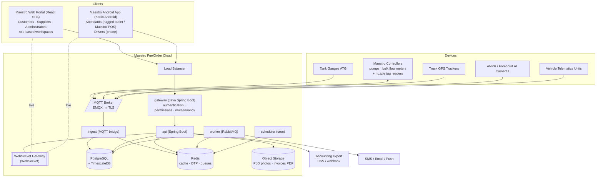
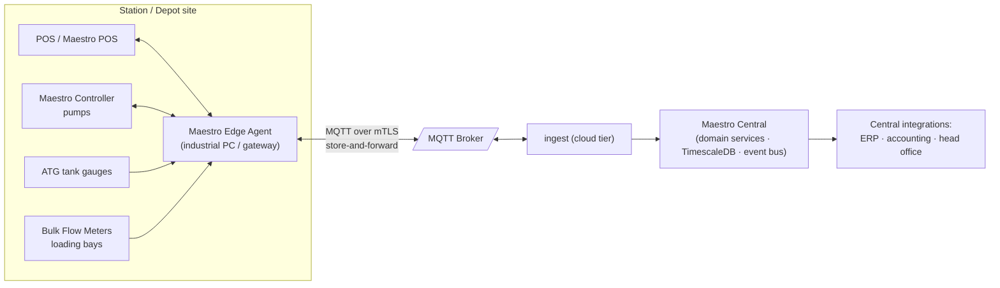

# 02 · Architecture

## 1. Architectural style

A single-stack **Java 21 + Spring Boot** backend: a **Spring Boot API Gateway** owns the
platform edge — authentication, permissions and multi-tenancy — in front of a **Spring Boot
modular monolith** that implements the domain modules (M1–M8), plus **Python services** for
AI fraud analytics. Module boundaries follow the functional modules so any module can later
be extracted into a microservice without API changes.

Processes:

| Process | Stack | Responsibility |
|---------|-------|----------------|
| `gateway` | Java 21 · Spring Cloud Gateway + Spring Security | TLS termination behind LB, **authentication** (token issuance/validation, sessions, MFA), **permissions** (coarse-grained route × role × scope policy), **multi-tenancy** (resolves tenant context, injects signed `X-Tenant-Context` headers), rate limiting, request audit |
| `api` | Java 21 · Spring Boot | REST API + WebSocket endpoint for all clients; fine-grained domain authorization |
| `ingest` | Java 21 · Spring Boot | Cloud tier of the **Maestro Integration Layer**: MQTT bridge — device telemetry → validation → TimescaleDB + event bus |
| `worker` | Java 21 · Spring Boot | RabbitMQ/Kafka consumers: alert evaluation + channel fan-out (in-app/SMS/email/WhatsApp), invoicing runs, reconciliation jobs, **report generation (JasperReports / Apache POI)** |
| `scheduler` | Java 21 · Spring Boot (Quartz) | Standing orders, OTP expiry sweeps, variance checks, aging, time-based alerts (pending approvals, collection windows, pump offline), alert escalation sweeps |
| `sentinel-ai` | **Python** (FastAPI) | AI fraud analytics: risk scoring models, consumption/flow anomaly detection, stockout forecasting, **CCTV event detection** (ONVIF / VMS integrations) — consumes events from the broker, emits risk events |

**Trust model:** clients only ever talk to the gateway. Domain services accept traffic
exclusively from the gateway (private network + mutual service auth) and *trust but verify*
the signed tenant/principal context, re-asserting row-level tenancy in the data layer.

## 2. System context



## 3. Backend module layout

```
backend/          # Gradle multi-module project (Java 21 + Spring Boot)
  gateway/        # Spring Cloud Gateway routes, Spring Security (JWT/MFA),
                  #   tenant-context filter, permission policies, rate limiting
  app-api/        # HTTP + WebSocket entrypoint
  app-ingest/     # MQTT entrypoint (Integration Layer cloud tier)
  app-worker/     # RabbitMQ/Kafka consumers + JasperReports/POI reporting
  app-scheduler/  # Quartz jobs
  module-auth/        # principal/tenant context propagation, fine-grained RBAC, device auth
  module-orders/      # M1 ordering + approval workflow engine
  module-dispensing/  # M2 OTP/token lifecycle, pump arming, transactions
  module-monitoring/  # M3 tank/pump telemetry, variance engine, dashboards
  module-pricing/     # M4 price lists, contracts, price resolution
  module-fraud/       # M5 Maestro Sentinel rules engine, cases, evidence
  module-fleet/       # M6 vehicles, drivers, consumption analytics
  module-logistics/   # M7 depots, stock, deliveries, GPS
  module-finance/     # M8 ledger, invoicing, payments, reconciliation
  module-alerts/      # cross-module alert rules: lifecycle, escalation
  module-notifications/ # templating + in-app/SMS/email/WhatsApp dispatch
  module-audit/       # append-only audit log interceptor
  module-shared/      # JPA entities, Flyway migrations, config, domain events, DTOs
sentinel-ai/      # Python (FastAPI): risk models, anomaly detection, forecasting,
                  #   CCTV event detection (ONVIF / VMS APIs)
clients/
  portal/         # Maestro Web Portal — React + TypeScript SPA (Vite), role-based
                  #   workspaces (Customer · Supplier/Control Centre + Wetstock · Admin)
  android/        # Maestro Android App — Kotlin (Jetpack Compose), role-based modes
                  #   (Attendant: rugged tablet / Maestro POS · Driver: phone)
```

**Inter-module communication** is event-driven: modules publish domain events
(`order.approved`, `dispense.completed`, `tank.reading`, `delivery.arrived`, …) via Spring
application events in-process and to **RabbitMQ/Kafka** for cross-process consumers
(sentinel-ai, worker, audit). This keeps module coupling low and makes later extraction
into services trivial.

## 4. Client architecture (React Web Portal + Android App)

Two role-based clients serve all five user types — Customers · Suppliers · Drivers ·
Attendants · Administrators. The gateway's permission model drives which workspaces/modes a
logged-in user sees.

- **Maestro Web Portal** (React + TypeScript SPA, responsive) — role-based workspaces:
  - *Customer*: branches, vehicles, drivers, purchase orders, fuel budgets & allocations,
    order approvals, transaction histories, credit balances, delivery receipts.
  - *Supplier (Station & Depot Control Centre)*: available stock, live pumps, loading bays,
    bulk flow meters, supplier review inbox, dispenser utilization, loading schedules,
    depot operational status, Wetstock Intelligence dashboards, load ticket printing.
  - *Admin*: pricing & billing, reconciliation exceptions, Maestro Sentinel fraud room,
    Wetstock fleet-wide views, platform administration, large exports.
- **Maestro Android App** (**Kotlin**, Jetpack Compose) — role-based modes:
  - *Attendant* (rugged tablets / Maestro POS): OTP entry, QR scanning (camera/hardware
    scanner), driver identity checks (PIN/photo), vehicle verification, dispensing
    authorization, digital signature capture, receipt printing via Bluetooth/USB,
    kiosk/lock-task mode, **offline queue** (validate signed QR tokens offline, sync when
    back online).
  - *Driver* (phones): fuel requests, OTP/QR wallet, delivery runs with GPS status,
    proof-of-delivery capture, delivery confirmation.
- **State & data**: portal — React Query for server state, WebSocket client for live
  updates (tank levels, pump status, order queue), Zustand for local UI state; Android —
  Retrofit/OkHttp + Room (offline queue) + WebSocket/FCM for live updates.
- **Offline strategy (Android App, Attendant mode)**: dispense authorizations are also
  issued as signed JWT-QR tokens; the app holds the platform public key and site allow-list
  so it can validate and record a dispense during connectivity loss, then reconcile on sync
  (flagged `OFFLINE_VALIDATED` for fraud review). **Fail-secure rule:** offline operation
  never *grants* validity — only authorizations that were issued and signed while online
  can be redeemed, within their original limits and expiry; the local Maestro Controller
  enforces the authorized litre limit during cloud interruptions, and an order is never
  treated as valid simply because the internet is unavailable.

## 5. Real-time design

| Channel | Transport | Examples |
|---------|-----------|----------|
| Device → cloud | MQTT (mTLS, per-device certs) | `station/{id}/tank/{id}/reading`, `station/{id}/pump/{id}/event`, `truck/{id}/gps` |
| Cloud → device | MQTT command topics | `station/{id}/pump/{id}/cmd` (arm/disarm with volume preset) |
| Cloud → users | WebSocket channels | `station:{id}` (console dashboards), `org:{id}` (order status), `delivery:{id}` (tracking map) |

The `ingest` process validates, deduplicates and timestamps device messages, writes raw
readings to TimescaleDB hypertables, updates Redis "latest state" hashes for cheap dashboard
reads, and republishes normalized domain events for fraud/variance evaluation.

## 6. Maestro Integration Layer

The integration tier that connects **Maestro Central** (the cloud platform) with site
equipment: **POS · Maestro Controller · ATG · Bulk Flow Meter**.



| Adapter | Equipment | Typical protocols | Direction |
|---------|-----------|-------------------|-----------|
| **Central** | head-office / ERP / accounting systems | REST webhooks, CSV/SFTP exports, API | Cloud ↔ external |
| **POS** | forecourt POS / Maestro POS terminals | IFSF, vendor APIs | Site ↔ cloud (sales, shifts, receipts) |
| **Controller** | Maestro Controllers (pump servers) | RS-485/current-loop, IFSF, vendor protocols | Bidirectional (telemetry up, ARM/PAUSE/STOP commands down) |
| **ATG** | automatic tank gauges (e.g. Veeder-Root TLS, OPW, Start Italiana) | serial/TCP gauge protocols | Site → cloud (levels, temp, water) |
| **Bulk Flow Meter** | loading-bay meters | Modbus RTU/TCP, pulse outputs | Site → cloud (loaded/offloaded volumes) |
| **CCTV** | forecourt cameras / VMS | **ONVIF, supported VMS APIs** (RTSP streams, event subscriptions) | Site → cloud (ANPR, vision events, evidence clips to sentinel-ai) |

**Maestro Edge Agent** (one per site, where equipment lacks native IP/MQTT): hosts the
protocol adapters, normalizes everything to the platform's MQTT topic scheme, buffers
**store-and-forward** during WAN outages, and executes locally-cached safety rules. During
cloud communication interruptions, the local **Maestro Controller enforces authorization
limits** (preset litres, expiry, vehicle binding) exactly as issued — **orders never
automatically become valid simply because the internet is unavailable** (fail-secure).
Modern IP/MQTT-capable devices may connect to the broker directly — the topic contract is
identical either way.

The cloud tier (`ingest`) validates, deduplicates (device ts + seq), persists to
TimescaleDB, refreshes Redis latest-state, and republishes normalized domain events for
monitoring, Sentinel and finance.

## 7. Data architecture

- **PostgreSQL** is the single source of truth for transactions, telemetry, events and
  audit logs. Spring Data JPA/Hibernate with **Flyway** migrations.
- **TimescaleDB hypertables** for `tank_readings`, `meter_readings`, `gps_positions` with
  continuous aggregates (5-min/1-hour rollups) and retention policies.
- **Redis**: cache and OTP state — OTP hashes with TTL, rate-limit counters, latest device
  state, WebSocket session fan-out (pub/sub).
- **RabbitMQ or Kafka**: background events — domain event distribution to worker and
  sentinel-ai, with dead-letter queues and replay.
- **Multi-tenancy with strict customer and supplier data isolation**: every commercial row
  carries `organization_id`; operator rows carry `site_id`. Enforced at three layers:
  gateway tenant context → Hibernate tenant filters on every query → composite indexes and
  row-level security policies in PostgreSQL.
- **Immutability**: `fuel_transactions`, `ledger_entries`, `audit_logs` are append-only
  (no UPDATE/DELETE grants; corrections via reversal entries).

## 8. Key design decisions

| # | Decision | Rationale |
|---|----------|-----------|
| D1 | Modular monolith first | One team can ship all 8 modules fast; boundaries preserved for later extraction |
| D2 | MQTT for devices, WebSocket for humans | Device constraints (QoS, tiny payloads, flaky links) differ from browser needs |
| D3 | Price snapshot on order line | Invoices must be immutable even if contracts change |
| D4 | OTP in Redis (hashed) + signed QR fallback | Fast validation online; offline-capable stations |
| D5 | Event-driven cross-module integration | Fraud/finance/audit observe everything without coupling |
| D6 | TimescaleDB over separate TSDB | One operational database; SQL joins between telemetry and business data power variance + fraud |
| D7 | Dedicated gateway service in front of domain services | Edge concerns (authentication, permissions, multi-tenancy, rate limiting) centralized on Spring Security/Cloud Gateway; domain services never exposed directly |
| D8 | Two role-based clients (Web Portal + Android App) | One portal and one app cover all five user types via scoped workspaces/modes — single codebase per platform, simpler distribution than per-role apps |
| D9 | Python for AI fraud analytics | ML ecosystem (scikit-learn/PyTorch, OpenCV for CCTV) lives in `sentinel-ai`; deterministic rules stay in Java for synchronous dispense-path decisions |
| D10 | Fail-secure offline dispensing | Local Maestro Controller enforces issued authorization limits during cloud interruptions; connectivity loss can never create validity — only pre-issued, signed, in-limit authorizations redeem offline |
