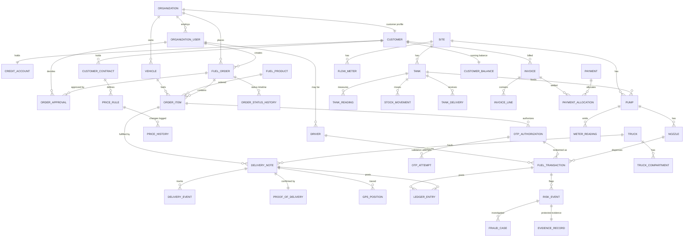

# 03 · Data Model

## 1. Canonical core entities

| Module | Main tables |
|--------|-------------|
| Organizations | `organizations`, `organization_users`, `roles` |
| Facilities | `sites`, `tanks`, `pumps`, `flow_meters` |
| Customers | `customers`, `customer_contracts`, `credit_accounts` |
| Pricing | `price_rules`, `price_history`, `contract_prices` |
| Orders | `fuel_orders`, `order_items`, `order_approvals` |
| OTP | `otp_authorizations`, `otp_attempts` |
| Fleet | `vehicles`, `drivers`, `vehicle_assignments` |
| Dispensing | `fuel_transactions`, `meter_readings` |
| Deliveries | `delivery_notes`, `proof_of_delivery` |
| Inventory | `tank_readings`, `stock_movements`, `tank_deliveries` |
| Fraud | `risk_events`, `fraud_cases`, `evidence_records` |
| Notifications | `notifications`, `notification_deliveries` |
| Finance | `invoices`, `payments`, `customer_balances` |
| Security | `audit_logs`, `device_sessions` |

**Order record guarantees:** every order has a globally unique identifier (UUID v7 +
human-readable number), a **complete status history** (`order_status_history`, append-only),
and an **immutable record** of approvals (`order_approvals`), price decisions
(`unit_price_snapshot` + winning rule reference on each item) and dispensing events
(`fuel_transactions`). None of these records are ever updated or deleted — corrections are
new records.

## 2. Entity-relationship overview



## 3. Detailed tables

Conventions: UUID v7 primary keys; `created_at`/`updated_at` timestamptz on all tables;
monetary values `numeric(14,4)`; volumes `numeric(12,3)` litres; soft-delete only where noted;
`organization_id` on all tenant-scoped tables.

### Organizations & identity

| Table | Key columns | Notes |
|-------|-------------|-------|
| `organizations` | name, type (`CUSTOMER`,`STATION_OPERATOR`,`DEPOT_OPERATOR`,`PLATFORM`), status | Tenant root; strict customer/supplier data isolation |
| `branches` | organization_id, name, code, geo, cost_center_default, status | Customer branches/sites; vehicles, budgets and orders can be branch-scoped |
| `organization_users` | organization_id, branch_id?, email, phone, password_hash, status, mfa_secret | |
| `roles` / `user_roles` | code (`ORG_ADMIN`,`FLEET_MANAGER`,`DRIVER`,`ATTENDANT`,`STATION_MANAGER`,`DEPOT_MANAGER`,`FINANCE`,`PLATFORM_ADMIN`), scope (org/site) | RBAC; scoped assignments |
| `api_devices` | site_id/truck_id, kind (`ATG`,`PUMP_CTRL`,`GPS`,`ANDROID_TERMINAL`), cert_fingerprint, status | Device identity for MQTT / Android terminals |
| `device_sessions` | api_device_id / user_id, token_hash, issued_at, expires_at, last_seen_at, ip, revoked_at? | Active sessions per device/user; remote revocation |

### Customers

| Table | Key columns | Notes |
|-------|-------------|-------|
| `customers` | organization_id (type CUSTOMER), trading_name, registration_no, vat_no, default_branch_id, status | Commercial profile of a customer organization |
| `customer_contracts` | customer_id, number, **currency**, valid_from/to, payment_terms_days, status | One or more agreements per customer — pricing is independent per customer even at the same site |
| `credit_accounts` | customer_id, credit_limit, terms (`PREPAID`,`NET_7`,`NET_30`,…), exposure (open orders + unbilled + unpaid), status (`OK`,`WARNING`,`BLOCKED`) | Checked at supplier review and authorization time |

### Fleet (M6)

| Table | Key columns | Notes |
|-------|-------------|-------|
| `vehicles` | organization_id, registration_no, fuel_product_id, tank_capacity_l, odometer_km, department, cost_center, status | |
| `drivers` | user_id, license_no, license_expiry, redemption_pin_hash, status | |
| `vehicle_assignments` | vehicle_id, driver_id, valid_from, valid_to | |
| `fuel_limits` | scope (vehicle/driver/department/org), scope_id, period (`DAY`,`WEEK`,`MONTH`), max_volume_l, max_amount | Enforced at order + authorization time |

### Pricing (M4)

| Table | Key columns | Notes |
|-------|-------------|-------|
| `fuel_products` | code (`DIESEL_50`,`ULP_93`,`ULP_95`,…), name, unit | |
| `price_lists` / `price_list_items` | region, currency, effective_from, status; fuel_product_id, unit_price | Versioned base prices (fallback) |
| `price_rules` | contract_id, fuel_product_id, **branch_id?**, **site_id?** (optional scopes), mode (`FIXED`,`DISCOUNT_ABS`,`DISCOUNT_PCT`,`INDEX_FORMULA`), value, min_volume_l (tier), **valid_from/to**, status (`PENDING_APPROVAL`,`ACTIVE`,`SUPERSEDED`) | Resolution precedence: branch+site rule+tier → site rule+tier → any-site rule+tier → contract base rule → regional price list; first match wins and the winning rule id is stored with the order-item snapshot |
| `contract_prices` | contract_id, fuel_product_id, site_id?, effective resolved unit_price, computed_at | Materialized effective prices per contract/product/site for fast lookup & customer display |
| `tax_rules` | region, fuel_product_id?, kind (`VAT`,`LEVY`,`DUTY`), rate_pct / fixed_per_l, effective_from/to | Applied on resolved net price; itemized on invoices |
| `delivery_surcharges` | contract_id? / region?, basis (`PER_KM`,`ZONE`,`SITE`,`FLAT`), value, min_qty_l?, effective_from/to | Bulk delivery surcharges; snapshotted with the order |
| `price_history` | subject (rule/list item), subject_id, **previous_price, new_price, proposed_by, approved_by, effective_date**, reason | **Append-only**; four-eyes enforced (proposer ≠ approver) |

### Orders (M1)

| Table | Key columns | Notes |
|-------|-------------|-------|
| `fuel_orders` | id (UUID v7), number (unique, human-readable), organization_id, branch_id?, **supplier_org_id**, **initiated_by** (`CUSTOMER`,`SUPPLIER`), purchase_order_no?, type (`VEHICLE_FILL`,`BULK_DELIVERY`,`STATION_REPLENISH`), status, requested_by, cost_center, **preferred_collection_at**, site_id?, delivery_site? | Orders may be customer-initiated or supplier-initiated; approval rules configurable per org |
| `order_items` | order_id, fuel_product_id, vehicle_id?, driver_id?, qty_ordered_l, qty_fulfilled_l, **unit_price_snapshot**, price_source (price_rule_id/price_list_id), status | Each item is an **allocation** (e.g. a 5 000 L bulk order split across several trucks — each gets its own item + OTP); order tracks the overall balance. Price frozen at approval |
| `order_status_history` | order_id, from_status, to_status, actor_id, reason?, ts | **Append-only** complete status timeline |
| `approval_policies` | organization_id, order_type, initiated_by?, min_amount, steps_json | Configurable chains per organization, for both customer- and supplier-initiated orders |
| `order_approvals` | order_id, **side** (`CUSTOMER`,`SUPPLIER`), step_no, approver_role, approver_user_id?, decision (`PENDING`,`APPROVED`,`REJECTED`,`CHANGES_REQUESTED`), decided_at, reason | **Immutable**; supplier review records stock/credit/pricing/equipment checks in `checks_json` |

### OTP (M2)

| Table | Key columns | Notes |
|-------|-------------|-------|
| `otp_authorizations` | order_item_id, code_hash (OTP), qr_token_jti, max_volume_l, site_id? (or any), vehicle_id, driver_id, expires_at, status (`ACTIVE`,`REDEEMED`,`EXPIRED`,`REVOKED`), redeemed_at | OTP never stored plaintext; single-use enforced atomically |
| `otp_attempts` | site_id, device_id, code_hash_tried, matched_authorization_id?, outcome (`SUCCESS`,`INVALID`,`EXPIRED`,`REUSED`,`RATE_LIMITED`), ts, ip | Every validation attempt logged — feeds brute-force & reuse detection |

### Dispensing (M2/M3)

| Table | Key columns | Notes |
|-------|-------------|-------|
| `fuel_transactions` | authorization_id, site_id, pump_id/flow_meter_id, nozzle_id?, attendant_user_id, driver_id, vehicle_id, volume_l, unit_price, amount, odometer_km, started_at, ended_at, totalizer_start, totalizer_end, mode (`AUTO_PUMP`,`MANUAL`,`OFFLINE_VALIDATED`) | **Append-only** |
| `meter_readings` *(hypertable)* | pump_id/flow_meter_id, ts, kind (`NOZZLE_UP`,`NOZZLE_DOWN`,`TOTALIZER`,`FLOW`,`ERROR`), value | Pump & bulk meter telemetry |

### Facilities & inventory (M3)

| Table | Key columns | Notes |
|-------|-------------|-------|
| `sites` | operator_org_id, kind (`STATION`,`DEPOT`), name, code, geo (lat/lng), timezone, status | Unified facility table for stations and depots |
| `tanks` | site_id, fuel_product_id, capacity_l, safe_fill_l, low_level_l | |
| `pumps` / `nozzles` | pump: site_id, tank_id, controller_device_id, **supports_safe_interruption**; nozzle: pump_id, fuel_product_id | Safe-stop capability gates `PUMP_CUTOFF` auto-action |
| `flow_meters` | site_id, loading_bay_name, tank_id?, meter_device_id, kind (`BULK_LOAD`,`BULK_OFFLOAD`), status | Bulk flow meters at loading bays |
| `tank_readings` *(hypertable)* | tank_id, ts, volume_l, **tc_volume_l** (15 °C corrected), level_mm, temp_c, water_mm | ATG stream |
| `tank_deliveries` | tank_id, delivery_note_id?, qty_documented_l, qty_measured_l (dip/meter), received_at, received_by | Inventory receipts into tanks; variance vs. documented qty |
| `stock_movements` | tank_id, kind (`DISPENSE`,`DELIVERY_IN`,`DELIVERY_OUT`,`ADJUSTMENT`,`CALIBRATION`), qty_l, ref_table/ref_id | Book stock ledger |
| `variance_snapshots` | tank_id, period, book_l, measured_l, dispensed_l, variance_l, status | Daily variance engine output |

### Deliveries (M7)

| Table | Key columns | Notes |
|-------|-------------|-------|
| `trucks` / `truck_compartments` | truck: reg_no, gps_device_id; compartment: capacity_l | |
| `delivery_notes` | number, order_item_id?, origin_site_id (depot), destination (site_id or customer site), truck_id, driver_id, status (`PLANNED`,`LOADING`,`IN_TRANSIT`,`ARRIVED`,`OFFLOADING`,`COMPLETED`,`CANCELLED`), planned_qty_l, loaded_qty_l, delivered_qty_l, seal_numbers | |
| `delivery_events` | delivery_note_id, ts, kind, payload_json, actor | Status timeline |
| `proof_of_delivery` | delivery_note_id, signed_by_name/role, signature_ref, photo_refs, dip_before/after or meter_qty, delivered_at, geo | Electronic PoD; completes the delivery |
| `gps_positions` *(hypertable)* | truck_id, delivery_note_id?, ts, lat, lng, speed | |

### Finance (M8)

| Table | Key columns | Notes |
|-------|-------------|-------|
| `ledger_entries` | organization_id, account (`FUEL_SALES`,`CUSTOMER_AR`,`STOCK`,…), debit, credit, currency, ref_table/ref_id, posted_at | **Append-only**, double-entry |
| `invoices` / `invoice_lines` | invoice: customer_id, number, period, due_date, status, totals; line: order_item/fuel_transaction refs, qty, unit_price_snapshot, tax, amount | Generated by billing run; PDF via JasperReports |
| `payments` / `payment_allocations` | payment: customer_id, method, amount, received_at, reference; allocation: payment→invoice amounts | |
| `customer_balances` | customer_id, currency, balance, unbilled_amount, overdue_amount, updated_at | Running balance view backing credit checks & statements |
| `reconciliation_runs` | site_id, business_date, status, totals_json, discrepancies_json | Daily close |

### Alerts & notifications (cross-module)

| Table | Key columns | Notes |
|-------|-------------|-------|
| `alert_rules` | code, category (`ORDER`,`DRIVER`,`INVENTORY`,`EQUIPMENT`,`SECURITY`,`DIVERSION`,`COMMERCIAL`,`FINANCIAL`,`FORECASTING`,`MAINTENANCE`,`RECONCILIATION`,`DELIVERY`), default_severity, params_json (thresholds, windows), escalation_minutes, escalation_chain_json, channels_json (per severity/role), enabled, scope overrides (org/site) | Seeded with the 12 categories; tunable per org/site |
| `alerts` | rule_code, category, severity, subject refs (order/tank/pump/driver/delivery/txn), details_json, status (`OPEN`,`ACKNOWLEDGED`,`ESCALATED`,`RESOLVED`), owner_user_id, acknowledged_by/at, escalated_level, resolved_by/at, resolution_note | Unacknowledged alerts auto-escalate up the chain |
| `notifications` | recipient_user_id, alert_id? / event ref, title, body, category, read_at?, created_at | In-app notification center entries |
| `notification_deliveries` | alert_id?, recipient_user_id, channel (`IN_APP`,`SMS`,`EMAIL`,`WHATSAPP`), template, status (`SENT`,`DELIVERED`,`FAILED`), provider_ref, sent_at | Delivery audit incl. WhatsApp Business provider refs |
| `notification_preferences` | user_id, channel, category, min_severity, quiet_hours | Per-user routing within role/rule constraints |

### Fraud & audit (M5 — Maestro Sentinel™)

| Table | Key columns | Notes |
|-------|-------------|-------|
| `fraud_rules` | code, description, severity, params_json, enabled, auto_action (`NONE`,`BLOCK_AUTH`,`SUSPEND_ACTOR`,`PAUSE_SUPERVISOR`,`PUMP_CUTOFF`,`REQUIRE_IDENTITY`) | `PUMP_CUTOFF` applied only on pumps with `supports_safe_interruption` |
| `risk_events` | rule_code, severity, risk_score, status (`OPEN`,`INVESTIGATING`,`CONFIRMED`,`DISMISSED`), subject refs (txn/driver/attendant/station), details_json, evidence_refs (camera stills, flow trace, telematics curve) | |
| `fraud_cases` | risk_event_id, status, assigned_to, notes (append-only entries), opened_at, closed_at, outcome | Investigation workflow |
| `evidence_records` | alert_id, cctv_clip_ref, txn_refs_json, pump_readings_json, driver_identity_json, gps_location, content_hash, prev_hash | **Append-only, hash-chained (tamper-evident)**; legal-hold object storage; investigator-only access, fully audited |
| `vehicle_tags` | vehicle_id, kind (`RFID`,`FILLER_RING`,`ANPR_PLATE`), tag_value, status | Container-diversion interlock identities |
| `telematics_readings` *(hypertable)* | vehicle_id, ts, fuel_level_pct, odometer_km, lat, lng | CAN-bus/fuel-sender stream for dispense cross-check |
| `anpr_events` | station_id, pump_id?, ts, plate, confidence, image_ref | Forecourt camera matches |
| `site_sensor_coverage` | station_id, has_filler_ring, has_anpr, has_vision, telematics_pct | Adapts fusion confidence thresholds per site |
| `audit_logs` | actor_id, actor_type, action, entity, entity_id, before_json, after_json, ip, ts | **Append-only**; written by interceptor |

## 4. Status enums (authoritative)

```text
OrderStatus:        DRAFT, PENDING_APPROVAL, PENDING_SUPPLIER_REVIEW, APPROVED, AUTHORIZED,
                    PARTIALLY_FULFILLED, FULFILLED, REJECTED, CHANGES_REQUESTED,
                    CANCELLED, EXPIRED
AuthorizationStatus: ACTIVE, REDEEMED, EXPIRED, REVOKED
DeliveryStatus:     PLANNED, LOADING, IN_TRANSIT, ARRIVED, OFFLOADING, COMPLETED, CANCELLED
InvoiceStatus:      DRAFT, ISSUED, PARTIALLY_PAID, PAID, OVERDUE, CREDITED, VOID
AlertStatus:        OPEN, INVESTIGATING, CONFIRMED, DISMISSED
```

## 5. Indexing & partitioning highlights

- Hypertables (`tank_readings`, `meter_readings`, `gps_positions`) partitioned by time (1-day
  chunks), compressed after 7 days, retained 13 months; continuous aggregates kept forever.
- `fuel_transactions (site_id, started_at)` and `(vehicle_id, started_at)` btree
  indexes — power reconciliation and fleet analytics.
- `otp_authorizations (code_hash) WHERE status = 'ACTIVE'` partial unique index —
  O(1) OTP lookup.
- `ledger_entries (organization_id, posted_at)`; monthly range partitions after year one.
