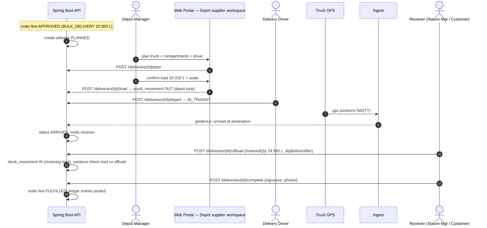
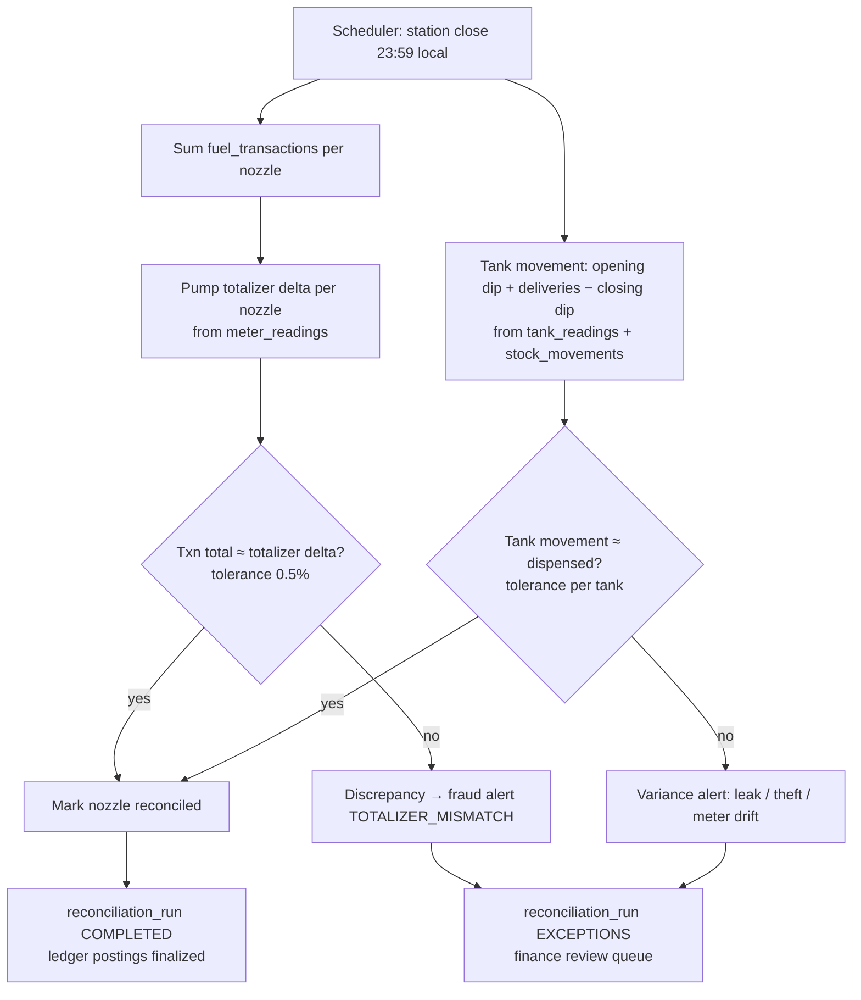
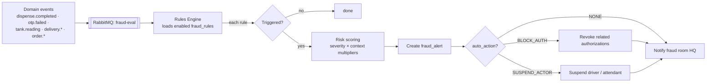

# 05 · Core Workflows

## 0. The canonical transaction workflow

| # | Step | Module | Surface |
|---|------|--------|---------|
| 1 | Customer submits order: supplier, station/depot, fuel grade, quantity, vehicle, driver, preferred collection date, cost centre | M1 | Web Portal — Customer workspace |
| 2 | Supplier receives order: checks stock availability, credit limit, customer pricing, dispensing equipment | M1 | Web Portal — Supplier workspace (review inbox) |
| 3 | Approval / rejection with reason / request changes → customer notified immediately | M1 | Web Portal (both workspaces) |
| 4 | OTP generation: secure, time-limited, bound to driver + vehicle + site + product + authorized quantity | M2 | Platform |
| 5 | Driver arrives: attendant enters OTP on rugged tablet / Maestro POS → system retrieves driver, vehicle, allocation | M2 | Android App — Attendant mode |
| 6 | Automated dispensing: Maestro Controller arms the pump / bulk flow meter and monitors litres against the order | M2 + M3 | Maestro Controller |
| 7 | Delivery confirmation: actual litres, pump readings, tank movements, timestamps, transaction references captured | M2 + M3 | Platform |
| 8 | Automatic notification: customer + driver receive confirmation; fuel balances, financial records and dashboards updated | M8 | Web Portal / Android App |

**OTP invariants:** a rejected (or changes-requested) order **never** generates an active OTP;
unused OTPs **expire automatically**; a redeemed OTP is **never reusable**
(see [OTP design](./06-security-and-fraud.md#3-otp--token-design-m2)).

## 1. Fuel order → supplier review → authorization (M1 + M2)

```mermaid
sequenceDiagram
    autonumber
    actor Cust as Customer / Driver
    actor FleetMgr as Fleet Manager
    actor Sup as Supplier (Station/Depot staff)
    participant API as Spring Boot API
    participant PR as Pricing
    participant WF as Approval Engine
    participant NTF as Notifications

    Cust->>API: POST /orders (supplier, site, grade, 60 L,\nvehicle, driver, collection date, cost centre)
    API->>API: check fuel limits & budgets (vehicle/driver/period)
    API->>PR: resolve price (contract → tier → list)
    PR-->>API: unit price snapshot
    API->>WF: submit → evaluate customer approval policy
    WF-->>API: step 1 = FLEET_MANAGER (amount > threshold)
    API->>NTF: notify approvers
    FleetMgr->>API: POST /orders/{id}/approvals/1 {APPROVED}
    WF-->>API: customer steps done → PENDING_SUPPLIER_REVIEW
    API->>NTF: notify supplier review inbox
    Sup->>API: GET /supplier/orders/{id}/checks\n(stock · credit · pricing · equipment)
    alt accepted
        Sup->>API: POST /supplier/orders/{id}/review {APPROVE}
        API->>API: status APPROVED → issue dispense authorization\n(OTP hashed → Redis+DB, QR JWT signed,\nbound to driver+vehicle+site+product+qty)
        API->>NTF: SMS/push OTP + QR to driver; confirm to customer
        API-->>Cust: order AUTHORIZED, OTP expires in 24 h
    else rejected / changes requested
        Sup->>API: POST /supplier/orders/{id}/review {REJECT | REQUEST_CHANGES, reason}
        API->>API: status REJECTED / CHANGES_REQUESTED\n(no OTP is ever issued)
        API->>NTF: immediate notification to customer with reason
    end
```

## 2. OTP redemption & automated dispensing (M2 + M3)

```mermaid
sequenceDiagram
    autonumber
    actor Driver
    actor Att as Attendant
    participant SC as Android App — Attendant mode (rugged tablet / Maestro POS)
    participant API as Spring Boot API
    participant RD as Redis
    participant MQ as MQTT Broker
    participant PMP as Maestro Controller (pump / bulk meter)
    participant FR as Fraud Engine

    Driver->>Att: presents OTP / QR
    Att->>SC: enter OTP or scan QR
    SC->>API: POST /dispense/validate {otp, stationId, vehicleReg, driverPin}
    API->>RD: hash(otp) lookup + rate-limit check
    RD-->>API: authorization (order line, driver, vehicle, max 60 L)
    API->>FR: pre-checks (driver & vehicle match, site allowed, window)
    FR-->>API: OK (risk score low)
    API-->>SC: valid → show driver, vehicle, allocation; pumps/bays for DIESEL_50
    Att->>SC: select Pump 3
    SC->>API: POST /dispense/start {authId, pumpId, nozzleId}
    API->>MQ: publish pump cmd ARM preset 60 L
    MQ->>PMP: ARM
    PMP-->>MQ: ack + flow events + totalizer (litres monitored vs. order)
    MQ->>API: dispense complete 58.4 L
    API->>API: capture actual litres, pump readings, tank movement,\ntimestamps, txn reference (append-only);\nmark auth REDEEMED (atomic — never reusable)
    API->>FR: post-evaluation (async, RabbitMQ)
    SC->>API: digital signature (driver) → delivery confirmation
    API-->>SC: receipt data → print
    API-->>Driver: final dispensing confirmation (SMS/push)
    API->>API: update fuel balances, ledger entries,\nmanagement dashboards (WebSocket)
```

**Offline branch:** if the console has no connectivity, it verifies the **QR JWT signature**
locally (platform public key), checks expiry/station binding, records the dispense locally,
and the attendant completes manually. On reconnect the console calls
`POST /dispense/offline-sync`; those transactions enter fraud review flagged
`OFFLINE_VALIDATED`, and the server rejects any that were already redeemed elsewhere
(double-spend check on sync).

## 3. Bulk delivery: depot → customer/station (M7)



## 4. Daily station reconciliation (M8 + M3)



## 5. Monthly billing run (M8 + M4)

1. Scheduler (or finance user) starts a billing run for period × organization.
2. Worker collects fulfilled order lines / dispense transactions not yet invoiced.
3. Lines grouped per contract; **snapshotted unit prices** used — never re-priced.
4. Invoice + lines created (`DRAFT`), PDF rendered to object storage, then `ISSUED`.
5. Ledger: debit `CUSTOMER_AR`, credit `FUEL_SALES`.
6. Payments captured later are allocated (`payment_allocations`); aging job updates
   `OVERDUE`; statements available per org per period.

## 6. Maestro Sentinel™ fraud evaluation pipeline (M5)



Detection → response matrix and container-diversion fusion: see
[06 · Security & fraud](./06-security-and-fraud.md).
