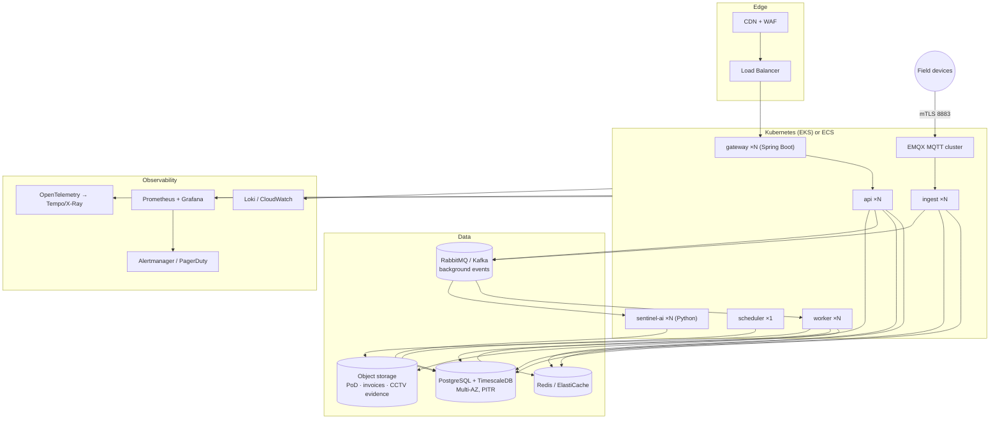

# 07 · Infrastructure & Deployment

## 1. Cloud topology (reference: any major cloud — AWS names shown)

## 2. Environments

| Env | Purpose | Data |
|-----|---------|------|
| `dev` | shared development, auto-deploy from `main` | seeded synthetic data + device simulators |
| `staging` | release candidates, UAT, station-console cert testing | anonymized production subset |
| `prod` | live | real; PITR backups, cross-region replica |

Device simulators (ATG/pump/GPS publishers) run as containers in dev/staging so every
workflow is testable without hardware.

## 3. CI/CD

- **Multi-repo-style monorepo**: Gradle multi-module (Java backend), pnpm (React portal),
  Gradle (Kotlin Android), Poetry/uv (sentinel-ai). Pipelines per affected module.
- Backend (Java 21): Gradle build → unit tests → integration tests (Testcontainers:
  Postgres/Redis/RabbitMQ/EMQX) → build images → deploy dev → e2e smoke → promote; gateway
  additionally runs contract tests against domain-service stubs.
- sentinel-ai (Python): ruff/mypy → pytest → model validation suite → image → same path.
- **Flyway** migrations applied via migration job before rollout; a review gate blocks
  destructive changes without an explicit flag.
- **Android App**: signed AAB/APK builds (Gradle), distributed via managed
  Google Play / MDM for rugged attendant tablets; staged rollout tracks `beta` → `stable`;
  minimum client version enforced by API for security-critical releases.
- Web Portal: static build → CDN with instant rollback.

## 4. Scaling & resilience

| Component | Strategy |
|-----------|----------|
| `api` | HPA on CPU/latency; stateless (WebSocket via Redis adapter) |
| `ingest` | scale with MQTT shared subscriptions; at-least-once + idempotent writes (device ts + seq dedupe) |
| `worker` | scale per queue depth; jobs idempotent + retry with backoff + DLQ |
| PostgreSQL | Multi-AZ failover; read replica for analytics/reporting queries |
| Redis | replicated; OTP data is reconstructible from Postgres on failover |
| Station operations | attendant tablets keep working offline (signed-QR validation + local queue) during cloud or link outages |
| `gateway` | HPA; stateless (local JWT validation; sessions/rate counters in Redis) |

## 5. Observability & SLOs

- OpenTelemetry tracing across API → queue → worker (traceId returned in error payloads).
- Golden dashboards: OTP validation latency, dispense success rate, telemetry ingest lag,
  queue depth, reconciliation exception rate.
- SLOs: API availability 99.9%; OTP validation p95 < 500 ms; telemetry end-to-end lag
  p95 < 5 s; alerting on burn rates.

## 6. Backup & DR

- Postgres: continuous WAL archiving, PITR, nightly snapshots (35-day retention),
  quarterly restore drills.
- Object storage: versioning + cross-region replication for financial documents.
- DR target: RPO ≤ 5 min, RTO ≤ 1 h (warm standby region for API + broker).
