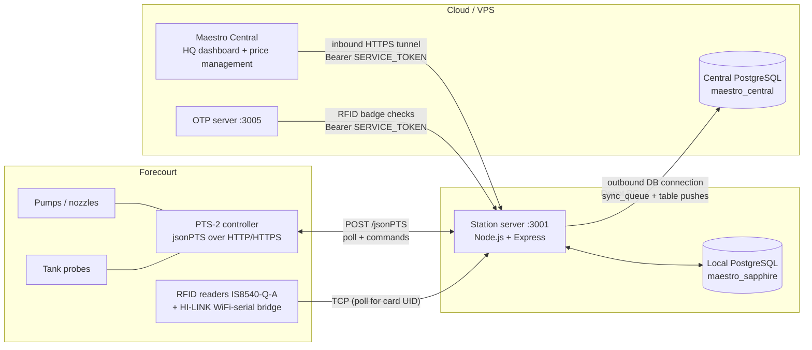
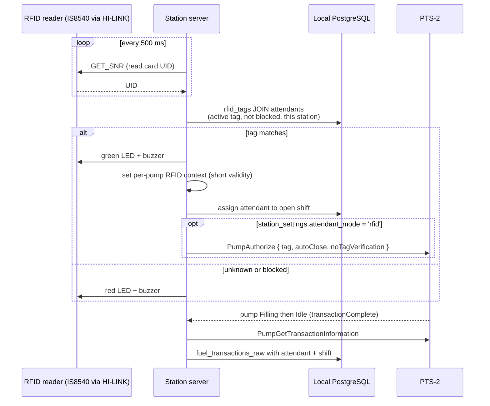
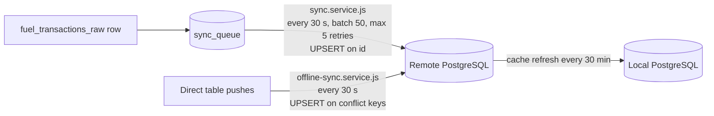

# 10. Station server integration: PTS-2, RFID, and cloud sync

How the on-site **station server** (`station-server-3001`, port 3001) talks to the forecourt
hardware and how its data reaches Maestro Central on the cloud/VPS.

**Evidence levels used below**

- **Code** — read directly in `station-server-3001`.
- **Guide** — stated in `station-server-3001/STATION-SERVER-SETUP.md` only. The Central/VPS side
  (`cloud/3-sapphire-maestro-central.sql`, `station_registry`, tunnel setup) is not in this repository,
  so those parts could not be checked against code.

## 1. Big picture

Design rule (Code): the station is **offline-first**. Every request the server handles reads and
writes the **local** PostgreSQL. Cloud sync is a separate, best-effort background job; a lost
internet connection never stops fuel from being recorded.

## 2. Station server to PTS-2 (pumps and tanks)

### 2.1 Transport — `lib/pts-client.js`

| Aspect | Behaviour |
|---|---|
| Protocol | **jsonPTS**: one HTTP `POST` to `PTS_URL` (default `https://192.168.1.90/jsonPTS`) |
| Request shape | `{ "Protocol": "jsonPTS", "Packets": [ { "Id": n, "Type": "<Command>", "Data": {...} }, ... ] }` |
| Batching | `createComplexRequest()` puts many commands in one request. For example, one `PumpGetStatus` packet per pump. |
| Auth | HTTPS uses **Basic**; HTTP uses **Digest** (handles the 401 challenge, then retries). Credentials: `PTS_USERNAME` / `PTS_PASSWORD`. |
| TLS | Self-signed certificates are accepted (`rejectUnauthorized: false`). |
| Errors | A top-level error throws. A per-packet error is logged and the other packets still succeed. `JSONPTS_ERROR_NOT_FOUND` means "device not configured" and is used to discover which pumps and probes exist. |
| Timeout | `PTS_TIMEOUT` (default 30 s) |

### 2.2 Commands used

| Area | PTS-2 commands |
|---|---|
| Pump status and transactions | `PumpGetStatus`, `PumpGetTransactionInformation`, `PumpGetTotals`, `ReportGetPumpTransactions` |
| Pump control | `PumpAuthorize`, `PumpLock`, `PumpUnlock`, `PumpStop`, `PumpEmergencyStop`, `PumpSuspend`, `PumpResume`, `PumpCloseTransaction` |
| Tanks | `GetProbesConfiguration`, `ProbeGetMeasurements` |
| Prices | `GetFuelGradesConfiguration`, `GetFuelGradesPrices`, `SetFuelGradesPrices`, `PumpGetPrices`, `PumpSetPrices`, `Get/SetPricesSchedulerConfiguration` |
| User/tag configuration | `AddUserConfiguration` |

### 2.3 Pumps — polling loop

`services/fuel.service.js` polls `PumpGetStatus` for all pumps in one batched request.
`services/pts-polling.service.js` wraps it, adds WebSocket broadcasting, and does the database writes.

1. **Discovery.** Until pumps are known it asks for pumps 1–20. Pumps that answer are remembered; ones answering `NOT_FOUND` are dropped. `pumpsToPoll` can pin an explicit list.
2. **State changes.** Each answer is compared with the previous one by packet `Type`:
   - `PumpFillingStatus` emits `pumpFilling`.
   - `PumpIdleStatus` emits `pumpIdle`.
   - Filling to Idle (the controller auto-closes the transaction) emits `transactionComplete`, using `LastTransaction`.
   - `PumpEndOfTransactionStatus` also emits `transactionComplete`.
3. **Transaction complete** (`pts-polling.service.js`):
   - Fetch full detail with `PumpGetTransactionInformation` (Tag, Volume, Amount, FuelGrade).
   - Work out the attendant and shift (see section 3).
   - `INSERT INTO fuel_transactions_raw ... ON CONFLICT (station_id, pump_id, transaction_id) DO NOTHING`.
   - Add the row to `sync_queue` for upload.
   - If the insert fails, park the payload in `pending_transactions` (nothing reads it automatically).
4. **Safety-net report pollers** catch fills the live loop missed:

| Poller | Interval | Command | Table |
|---|---|---|---|
| `pts-polling.service.js` | every 2 min (`TRANSACTION_POLL_INTERVAL_MS`) | `ReportGetPumpTransactions` (pump 0 = all) | `pump_transaction_reports` |
| `pump-report-polling.service.js` | every 60 s | `ReportGetPumpTransactions` (pump 0) | `pump_report_transactions` (richer fields) |
| `pts-sales-polling.service.js` | every 30 s | `QueryTransactions` | `pts_sales`. **Inert** on this controller (`NOT_FOUND`). |

The controller speaks station wall-clock time (Africa/Lusaka) with no zone suffix, so the report
queries are formatted in local time.

### 2.4 Tanks — probe polling

- `fuel.service.js` calls `ProbeGetMeasurements` per configured probe. Probe IDs come from `GetProbesConfiguration`, or by discovery.
- Each reading is held in memory and emitted as `tankUpdate` (product volume and height, water height, temperature, ullage, fill %).
- `pts-polling.service.js` broadcasts it over WebSocket and calls `storeTankMeasurement()`. It keeps at most **one row per tank per 5 min** (`TANK_MEASUREMENT_INTERVAL_MS`) in `tank_measurements`, de-duplicated on `(pts2_tank_id, date_time)`.

### 2.5 Control and prices (station server to PTS-2)

- HTTP routes under `/api/pts/pump/:n/{lock,unlock,authorize,stop,emergency-stop,suspend,resume}` map to the matching PTS commands.
- Fuel prices: `PUT /api/fuel-grades/prices`, `/schedules` and `/pump/:n/prices` write to the controller (`SetFuelGradesPrices`, etc.). Changes are logged to `price_change_log` and later pushed to the cloud.

### 2.6 Live view

`index.js` runs a WebSocket server on the same port. A new client immediately gets the cached pump
and tank status. After that it gets `statusUpdate`, `pumpFilling`, `pumpIdle`, `transactionComplete`,
`tankUpdate`, `rfidScan` and similar events.

## 3. RFID

**RFID readers do not talk to the PTS-2.** They connect straight to the station server over TCP.
The station server then tells the PTS-2 what to do.

**Link to the reader.** `services/rfid-reader.service.js` opens a TCP connection per active row in
`rfid_readers` (port 8080 by default, through a HI-LINK WiFi-to-serial bridge at 9600 baud). Frames are
`0xAA ... BCC 0xBB`. It polls for card UIDs, debounces repeats (`RFID_DEDUP_MS`, 2 s), and
auto-reconnects with backoff. Each reader covers one or more pumps (`pump_ids`). `rfid_reader_pumps` is
also in the schema.

**Matching.** `lookupAttendant` joins `rfid_tags` to `attendants`. The tag must be active and assigned,
the attendant not blocked, and `rfid_tags.station_id` must equal this server's `STATION_ID`.
`attendants.tag_number` is a legacy fallback.

**Two modes** (`station_settings.attendant_mode`, changed with `PUT /api/rfid/mode`):

| Mode | Scan does |
|---|---|
| `manual` | Records who is on which pumps only. Pumps run freely. |
| `rfid` | Also sends `PumpAuthorize` for each idle pump the reader covers. Each fill needs a new scan. |

**Attributing the fill.** When a fill finishes, the attendant is found in this order: (1) the `Tag` the
PTS-2 reports on the transaction, looked up in `rfid_tags`; (2) the stored authorization context; (3) the
in-memory RFID context. Missing shifts are linked afterwards from the attendant's open shift.

**OTP server link (Guide).** The OTP server on :3005 calls the station server for badge checks. Its
`STATION_SERVICE_TOKEN` must equal this server's `SERVICE_TOKEN`.

**Admin API:** `/api/rfid/{readers,tags,attendants,mode,status,logs,reload,active,authorizations,transactions}`.

## 4. Station server to cloud / VPS

Three separate paths.

### 4.1 Outbound: station pushes up (Code)

The station opens its own **direct PostgreSQL connection** to a remote database (`DATABASE_URL`,
`ssl.rejectUnauthorized=false`). The code calls this remote "Supabase"; the setup guide describes it as
the VPS `maestro_central` database. Confirm which one you actually run.

**A. Queue sync (`sync.service.js`).** Writers add `(table_name, record_id, operation, payload)` to
`sync_queue`. A cycle sends pending items as UPSERT, UPDATE or DELETE, marks `is_synced`, and counts
`sync_attempts` on failure. It runs only when both local and remote are reachable.

**B. Table pushes (`offline-sync.service.js`).** A second loop pushes unsynced rows straight from
local tables. It checks the remote every 10 s (`connection-status.service.js`) and syncs immediately on reconnect.

| Direction | Data |
|---|---|
| **Push** (local to remote) | `fuel_transactions_raw` (key `station_id, transaction_id`), `fuel_transactions_verified`, shifts and shift attendants and cash-up and close declarations, `pts_sales` / `pts_sales_records`, `pump_transaction_reports`, debtors / debtor vehicles / drivers, attendants, attendant tags, attendant shifts, companies, stations, pumps, `price_change_log`, `audit_log` |
| **Pull** (remote to local, every 30 min; `AUTO_PULL_ON_STARTUP` for startup) | users (for offline login), attendants, employees, stations, attendant tags, attendant shifts, verified transactions (managers verify on the web dashboard) |

**Not found in the push code (gaps to confirm):** `tank_measurements` (what the poller actually writes) and
`pump_report_transactions`. `tank_readings` is listed in the sync table list, but the poller never writes it.
Tank history may therefore stay on the station.

**Resilience.** Failures are retried with backoff. A fill is never lost to a dead connection, because the
local insert has already committed.

### 4.2 Inbound: Central calls the station (Code + Guide)

- **Code:** `middleware/auth.js` accepts `Authorization: Bearer <SERVICE_TOKEN>` (constant-time compare) and gives the caller a service identity with roles `service` and `admin`, scoped to this station. This is how Central pushes prices and fan-outs company-scoped reads (`/api/company/*?company_id=...`).
- **Guide:** Central reaches the station through an **inbound cloudflared tunnel** (a hostname mapped to `localhost:3001`). Central stores that URL and the service account in its `station_registry`. The account Central logs in as must have the admin or manager role, or price pushes fail with 403.

### 4.3 Identity

Rows are scoped by `COMPANY_ID` / `STATION_ID` (and `OFFLINE_*`). They must be stable UUIDs. If they
change, run `scripts/fix-station-identity.js`, or RFID lookups stop matching (`station_id` filter).

## 5. Key configuration

| Variable | Used for |
|---|---|
| `PTS_POLLING_ENABLED` / `PTS_URL` / `PTS_USERNAME` / `PTS_PASSWORD` | Turns on PTS polling and points at the controller. |
| `RFID_ENABLED`, `RFID_POLL_INTERVAL_MS`, `RFID_DEDUP_MS` | RFID reader service |
| `TRANSACTION_POLL_INTERVAL_MS`, `PUMP_REPORT_POLLING_INTERVAL`, `PTS_SALES_POLLING_INTERVAL`, `TANK_MEASUREMENT_INTERVAL_MS` | Poll and storage intervals |
| `COMPANY_ID`, `STATION_ID`, `OFFLINE_COMPANY_ID`, `OFFLINE_STATION_ID`, `OFFLINE_SCOPE_MODE` | Station identity and sync scoping |
| `LOCAL_DB_*` | Local PostgreSQL (this station's data) |
| `DATABASE_URL` | Remote database for sync |
| `SYNC_INTERVAL_MS`, `OFFLINE_SYNC_INTERVAL_MS`, `SYNC_BATCH_SIZE`, `SYNC_MAX_RETRIES`, `CACHE_REFRESH_INTERVAL_MS`, `AUTO_PULL_ON_STARTUP` | Sync behaviour |
| `JWT_SECRET`, `SERVICE_TOKEN` | Local login tokens; Central and OTP-server access |

## 6. Risks worth tracking

- `JWT_SECRET` falls back to a hard-coded dev value if unset. Set a real one.
- `SERVICE_TOKEN` grants admin rights to whoever holds it. It must be unique per station and kept secret.
- TLS verification is off for both the PTS-2 and the remote database connection.
- Some code comments disagree with behaviour (for example, a comment says RFID is "tracking only", yet `rfid` mode sends `PumpAuthorize`). Trust the code.
- `pending_transactions` has no automatic replay. Parked fills are invisible to reports.
